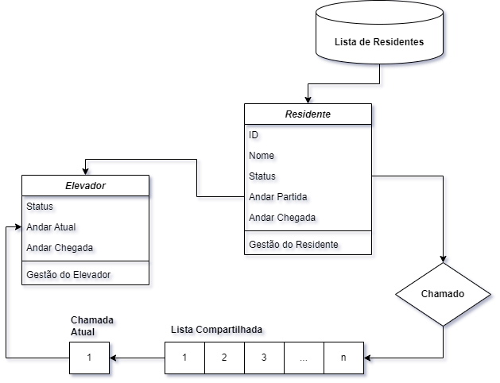
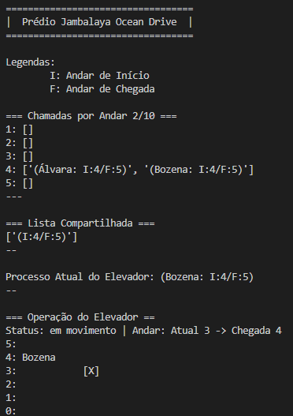

# Sistemas em Tempo Real [UFCG]
***

* [Vídeo de Apresentação](https://www.youtube.com/watch?v=tGET-bNy-5c)

# Sistema Simplificado de Controle de Elevador

<div align="center">
  
  <br>
  <em>Figura 1: Diagrama esquemático da aplicação.</em>   
</div>

## Visão Geral

O projeto consiste em um sistema de simulação de elevador que gerencia as solicitações de residentes de um prédio. O sistema é composto por três módulos principais:

1. **[elevador.py](projeto-1/elevador.py)**: Contém a classe `simulacao_elevador`, que simula o comportamento do elevador, incluindo seu movimento e status.
2. **[residentes.py](projeto-1/residentes.py)**: Contém a classe `simulacao_residentes`, que simula o comportamento dos residentes do prédio, incluindo suas solicitações de uso do elevador.
3. **[main.py](projeto-1/main.py)**: É o módulo principal que coordena a interação entre os residentes e o elevador, utilizando threads para simular a concorrência de solicitações e o movimento do elevador.

## Como o Sistema Funciona

### Módulo `elevador.py`

A classe `simulacao_elevador` é responsável por simular o comportamento do elevador. Ela mantém o estado atual do elevador, incluindo seu status (parado ou em movimento), o andar atual e o andar de destino. O elevador pode ser movido para cima ou para baixo, dependendo do andar de destino definido.

- **Métodos Principais**:
  - `__init__`: Inicializa o elevador com um andar inicial.
  - `__cria_dicionario_elevador`: Cria um dicionário para armazenar as informações do elevador.
  - `get_dados_elevador`: Retorna os dados atuais do elevador.
  - `set_chegada`: Define o andar de destino do elevador.
  - `set_status`: Define o status do elevador (parado ou em movimento).
  - `movimenta_elevador`: Move o elevador em direção ao andar de destino.

### Módulo `residentes.py`

A classe `simulacao_residentes` simula o comportamento dos residentes do prédio. Cada residente pode estar em um dos três estados: ocioso, em espera (aguardando o elevador) ou no elevador. Os residentes fazem solicitações aleatórias para usar o elevador, indicando o andar de partida e o andar de destino.

- **Métodos Principais**:
  - `__init__`: Inicializa a lista de residentes e seus estados.
  - `__cria_dicionario_gestao`: Cria um dicionário para armazenar os dados dos residentes.
  - `get_gestao`: Retorna os dados de todos os residentes.
  - `set_status`: Define o status de um residente.
  - `set_andares`: Define os andares de partida e destino de um residente.
  - `get_por_status`: Retorna uma lista de residentes com um determinado status.
  - `get_dados_residente`: Retorna os dados de um residente específico.
  - `inicia_chamada`: Inicia uma chamada de elevador para um residente ocioso.
  - `get_chamados_por_andar`: Retorna as chamadas de residentes em um determinado andar.

### Módulo `main.py`

O módulo `main.py` é o núcleo do sistema, onde as threads são criadas para gerenciar as solicitações dos residentes e o movimento do elevador. Ele utiliza semáforos para controlar o acesso concorrente à lista de chamadas e ao elevador.

- **Funções Principais**:
  - `solicita_elevador`: Gera solicitações aleatórias de residentes para usar o elevador.
  - `processa_chamado`: Processa as solicitações na lista compartilhada e as envia para o elevador.
  - `move_elevador`: Controla o movimento do elevador com base nas solicitações processadas.
  - `visualiza_lista_por_andar`: Exibe as solicitações de elevador categorizadas por andar.
  - `visualiza_lista_compartilhada`: Exibe a lista compartilhada de solicitações.
  - `visualiza_processo_atual`: Exibe o processo atual de controle do elevador.
  - `visualiza_elevador`: Exibe uma interface simples que ilustra a localização do elevador e o posicionamento do residente.
  - `interface`: Exibe a interface da aplicação, atualizando-a periodicamente.

<div align="center">
  
  <br>
  <em>Figura 2: Visualização da interface no terminal.</em>
</div>

## Como Compilar e Executar o Projeto

### Pré-requisitos

- Python 3.x instalado.
- Módulos `threading`, `random`, `time`, e `os` (todos são padrão na biblioteca do Python).

### Passos para Executar o Projeto

1. **Baixe os arquivos**:
   - Certifique-se de que os arquivos `elevador.py`, `residentes.py` e `main.py` estejam no mesmo diretório.

2. **Execute o programa**:
   - Abra um terminal ou prompt de comando.
   - Navegue até o diretório onde os arquivos estão localizados.
   - Execute o comando:
     ```bash
     python main.py
     ```

3. **Interface do Sistema**:
   - Após executar o comando, a interface do sistema será exibida no terminal.
   - A interface mostrará:
     - As chamadas de elevador por andar.
     - A lista compartilhada de solicitações.
     - O processo atual do elevador.
     - A localização do elevador e o residente que está sendo transportado.

4. **Encerrando o Programa**:
   - O programa não possui um sistema de parada automática. Para encerrar a execução, pressione `Ctrl + C` no terminal.